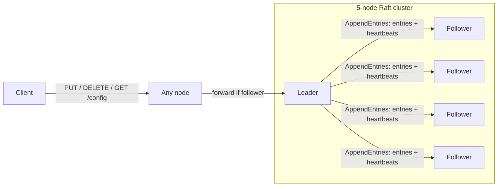
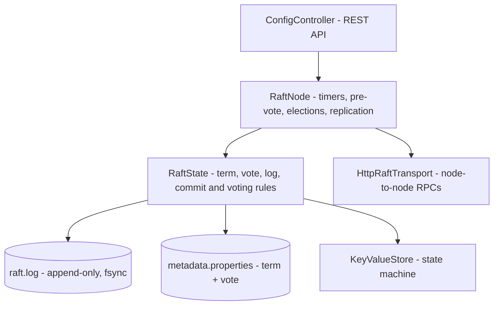

# Raft-Based Distributed Configuration Service

A 5-node implementation of the **Raft consensus algorithm** in Java 21, with a **Spring Boot REST API** for a replicated key-value configuration store. It runs locally, in Docker Compose, and on Kubernetes, and it comes with an automated fault-injection test that kills the leader during continuous writes.

**Highlights**

- Leader election with randomized timeouts and **Pre-Vote** (Raft thesis §9.6)
- Log replication with consistency checks, conflict truncation, and back-off
- Majority commit following the **Figure 8 rule**, plus a leader no-op on election
- **Durable state**: term, vote, and log are `fsync`ed before replying to any RPC
- Writes return **only after commit**; followers forward writes to the leader
- **Linearizable reads** via ReadIndex, or fast local reads on request
- Deployed as a Kubernetes **StatefulSet** with a persistent volume per pod
- **Measured:** median failover of **~180 ms** over 20 leader kills, **0 acknowledged writes lost**, and identical committed logs on all nodes

---

## Architecture



Inside each node:



The Raft core (`RaftState`, `RaftLog`, `RaftNode`) is plain Java with no Spring dependency. Spring only wires it to HTTP. That separation is what lets the safety rules be unit-tested directly, with no network or timers.

**Write path**

1. The client sends `PUT /config/{key}` to any node. A follower forwards it to the leader (one hop at most).
2. The leader appends `SET key value` to its log (fsync) and replicates it right away instead of waiting for the next heartbeat.
3. Each follower checks `prevLogIndex`/`prevLogTerm`, appends the entries (fsync), and acknowledges.
4. Once a majority (3 of 5) has the entry, and it belongs to the leader's current term, it's committed and applied to the key-value store.
5. Only then does the client get `200`.

---

## What's implemented

| Area | Details |
|---|---|
| Elections | Randomized 150–300 ms timeouts, RequestVote with the up-to-date log check, one vote per term |
| Pre-Vote | Candidates first ask "would you vote for me?". Peers refuse while they still hear from a leader (leader stickiness), so a node with delayed heartbeats can't depose a healthy leader. |
| Replication | `nextIndex`/`matchIndex` per follower, back-off on mismatch, idempotent appends, at most one RPC in flight per follower |
| Commit | Majority of replicas, counting only current-term entries (Figure 8), plus a no-op appended on election |
| Persistence | Term and vote written via temp file → fsync → atomic rename. Append-only log with one fsync per batch; a torn last line is discarded on startup. |
| Writes | Return after commit and apply. `409` not leader · `503` leadership lost (outcome unknown) · `504` no quorum (may still apply later) |
| Reads | Default **linearizable** (ReadIndex: confirm leadership with a majority, wait for apply). `?consistency=local` for fast, possibly stale reads. |
| Restarts | Raft starts only once the web server is ready, and stops first on shutdown, before the HTTP server drains |

---

## API

| Method | Path | Description |
|---|---|---|
| `PUT` | `/config/{key}` | Body = value. Returns `{key, value, index}` after commit. |
| `DELETE` | `/config/{key}` | Returns `{key, deleted, index}` after commit. |
| `GET` | `/config/{key}` | Linearizable read; add `?consistency=local` for a local read. |
| `GET` | `/config` | All keys, with the same consistency options. |
| `GET` | `/status` | Role, term, leader, log and commit positions; replication progress on the leader. |
| `GET` | `/admin/log-hash` | SHA-256 of the committed log, used to compare nodes. |

```bash
curl -X PUT localhost:8081/config/color -H "Content-Type: text/plain" -d "blue"
# {"key":"color","value":"blue","index":2}
curl localhost:8083/config/color
# {"key":"color","value":"blue"}
```

---

## Running it

Requires Java 21+ and Maven. The helper scripts are written for **Git Bash on Windows** (`kill-node.sh` uses `netstat`/`taskkill` in local mode).

### Local (5 JVMs on ports 8081–8085)

```bash
mvn clean package            # also runs the unit tests
bash run-cluster.sh
bash status.sh               # one LEADER, four FOLLOWERs
bash put.sh color blue
bash show-kv.sh
bash stop-cluster.sh
```

### Docker Compose

```bash
docker compose build         # multi-stage build; runs the unit tests inside Docker
docker compose up -d
bash status.sh               # host ports 8081-8085 map to each container
docker compose down          # add -v to also delete the data volumes
```

### Kubernetes (tested on Docker Desktop)

```bash
docker compose build                     # builds raft-config-service:latest locally
kubectl apply -f k8s/raft.yaml
kubectl rollout status statefulset/raft
curl localhost:8090/config               # load-balanced client Service
bash status.sh                           # per-pod Services on 8081-8085 (raft-0 ... raft-4)
```

| Kubernetes object | Purpose |
|---|---|
| StatefulSet `raft` (5 replicas) | Stable pod names `raft-0` … `raft-4`, used as Raft node IDs |
| Headless Service `raft` | Peer DNS (`raft-2.raft`), published even before pods are ready |
| `volumeClaimTemplates` | One PersistentVolume per pod: a recreated pod keeps its term, vote, and log |
| Service `raft-client` | Load-balances clients across all ready pods; any pod forwards writes to the leader |

---

## Testing

### Unit tests (20, about 1 s)

`mvn test` runs them directly against `RaftState` and `RaftLog`: one vote per term, stale terms, the up-to-date log rule, gap and mismatch rejection, duplicate RPCs, conflict truncation, a delayed old RPC not truncating, commitIndex capping, **Figure 8**, client writes completing only after a majority, step-down failing pending writes, Pre-Vote changing no state, vote and log surviving a restart, torn-write recovery, and escaped commands.

### Fault-injection test

`bash failover-test.sh 20` works the same against local JVMs, Docker, or Kubernetes:

1. A background writer streams writes, each to a unique key, through any node, retrying on errors.
2. Repeatedly: kill the leader, detect the new leader **by term**, record how long the cluster was leaderless, and restart the killed node.
3. Wait for all nodes to converge, then check that **every committed log has the same SHA-256** and that **every acknowledged write is in the store**.

---

## Results

All runs were on one Windows laptop: 5 nodes plus the test client.

| Environment | Leader kills | Leaderless time: min / median / p90 / max | Acked writes lost | Committed logs |
|---|---|---|---|---|
| Local JVMs | 20 | 102 / **178** / 395 / 467 ms | 0 of 2,839 | identical (2,862 entries) |
| Docker Compose | 5 | 207 / **220** / 523 / 523 ms | 0 of 1,024 | identical |
| Kubernetes | 20 | 177 / **271** / 525 / 570 ms | 0 of 2,625 | identical (6,515 entries) |

**How it's measured.** Locally, the time runs from the kill to the moment the new leader takes office, both on the same clock. In Docker and Kubernetes, the container clocks differ from the host's, so the **new leader measures it on its own clock**, from the last heartbeat it received to taking office. That overstates the time by up to one heartbeat interval (≤ 50 ms).

**Other results**

- **Pre-Vote:** before adding it, 5 leader kills used ~165 terms, because followers with briefly delayed heartbeats kept deposing healthy leaders. After: **7 terms for 5 kills** (24 for 20 kills locally).
- **Persistence:** the config survived deleting all 5 Kubernetes pods at once, scaling to zero and back, and a Docker Desktop crash.
- **No quorum:** with 3 of 5 nodes down, writes return `504` and linearizable reads return `503`. Writes accepted before that are applied once a majority returns.

---

## Design notes and lessons

- **Why a write needs a majority:** any two majorities of 5 overlap, so a newly elected leader always has every committed entry (it needs votes from a majority, and voters refuse candidates with older logs).
- **Figure 8:** a leader never commits an old-term entry by counting replicas. It commits its own no-op, and everything before it commits with it.
- **Outcome unknown is a real state:** if the leader dies after appending a write but before replying, the write may still commit. The API says so (`503`/`504`), and since `SET`/`DELETE` are idempotent, clients can safely retry.
- **Clocks across machines don't agree:** the first containerized measurements came out negative because the container VM's clock differed from the host's. Raft avoids this by ordering events with terms, and the test now does the same.
- **Infrastructure details matter:** a terminating pod kept heartbeating during Spring's graceful shutdown, which delayed elections, so Raft now stops first. Recreated pods come back with new IPs, so the JVM's 30 s DNS cache was shortened.
- **Remaining observation:** on Kubernetes, extra terms appear while a deleted pod restarts. My best explanation is CPU contention from the booting JVM in Docker Desktop's single small VM delaying heartbeats to several followers at once. Every safety check still passed. In production, guaranteed CPU per pod or longer election timeouts would trade slower failover for fewer elections.

---

## Limitations

- No log compaction or snapshots: the log grows without bound and is replayed in full on restart.
- No cluster membership changes: the 5 peers are fixed in configuration.
- Faults tested are crashes and restarts of **one node at a time**, plus loss of quorum. Network partitions are not tested.
- Node-to-node traffic is HTTP/JSON with no TLS or authentication.
- Every write is a separate log entry with an fsync on each node, so throughput isn't optimized.

---

## Project structure

```
src/main/java/com/raftconfig/
├── raft/           RaftState, RaftNode, RaftLog, MetadataStore, RPC records
├── store/          KeyValueStore (state machine)
├── transport/      HttpRaftTransport
├── api/            ConfigController, LeaderForwarder, StatusController, AdminController, RaftRpcController
└── config/         NodeProperties, RaftConfiguration (Spring wiring)
src/test/java/...   RaftStateTest, RaftLogTest
k8s/raft.yaml       StatefulSet, Services, PVCs
Dockerfile, docker-compose.yml
*.sh                run/stop/kill/start nodes, status, failover-test
```

---

## References

- Diego Ongaro and John Ousterhout, *In Search of an Understandable Consensus Algorithm* (Raft paper), 2014
- Diego Ongaro, *Consensus: Bridging Theory and Practice* (PhD thesis), 2014: Pre-Vote (§9.6), ReadIndex (§6.4)